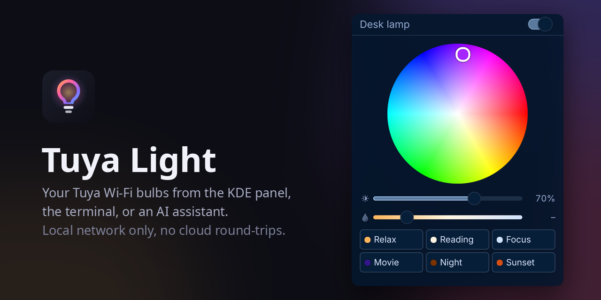
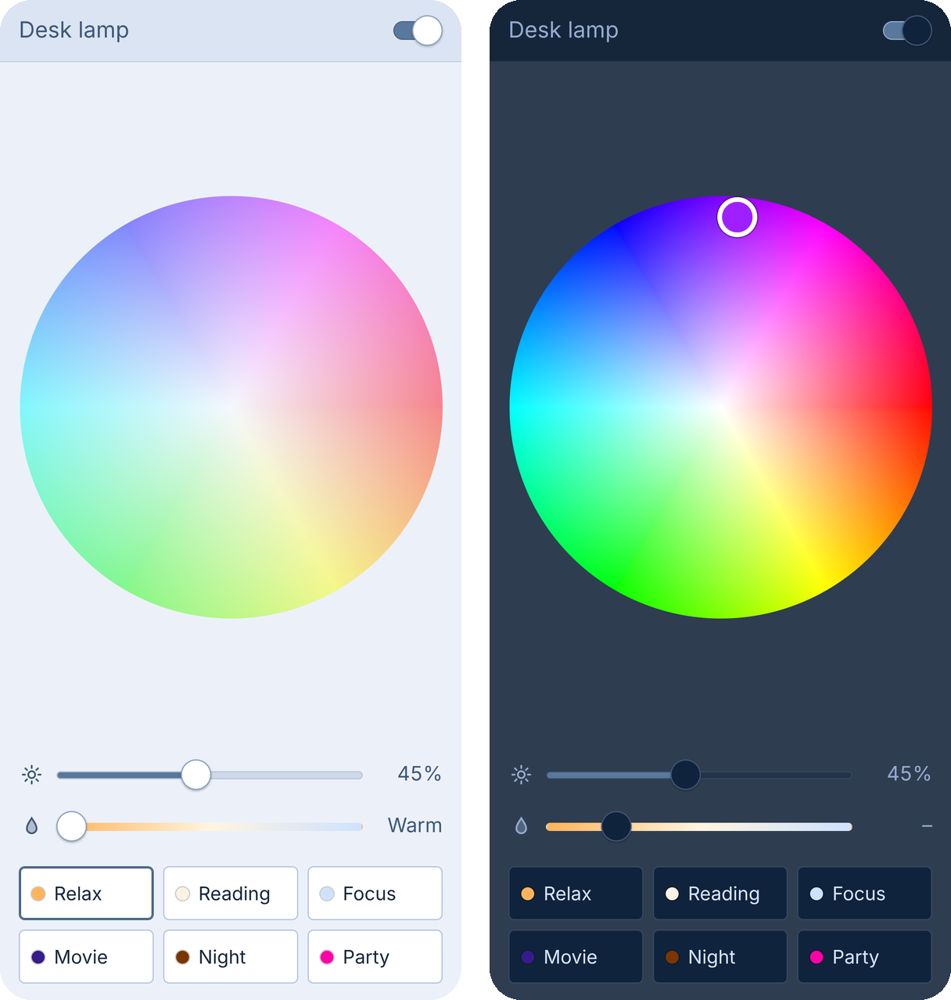
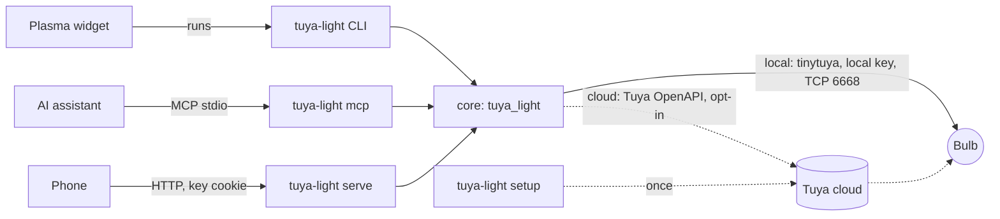

#  Tuya Light

[](https://github.com/YakupEmreYerli/tuya-light/actions/workflows/ci.yml) [](LICENSE) [](https://kde.org/plasma-desktop/) [](https://modelcontextprotocol.io)

Control Tuya Wi-Fi bulbs (Smart Life, Tuya Smart, and the many brands built on them) from a KDE Plasma panel widget, a command-line tool, an MCP server for AI assistants, and a page on your phone. By default they all talk to the bulb directly over your local network. For a server that isn't at home there is an opt-in cloud backend that goes through Tuya's own API.

> Türkçe: [README.tr.md](README.tr.md)



The phone app goes through Tuya's cloud for every tap. Tuya Light uses the bulb's local key instead, so commands land in a few hundred milliseconds and keep working if the cloud is slow or your developer account's trial has ended. In local mode the cloud is needed once, during setup, to fetch that key.

## Features

- **Panel widget.** A bulb icon that takes the light's current colour. Click for a colour wheel, a brightness slider, a warm-to-cool white slider, favourite colours and your scenes. Several bulbs get a picker at the top.
- **Your own scenes.** Create, edit, hide and delete scenes in the widget's settings, or save whatever the light shows right now. Built-in ones can be edited and restored. The command line, the MCP server and the phone page see the same list, and [linked installs](#sharing-settings-between-installs) share it.
- **Make it yours.** Choose which popup sections appear and in what order, the wheel size, scene columns and favourite colours; what left click, middle click and the scroll wheel do (open, switch, a scene; brightness, warmth or colour); the panel icon (four shapes, tinted or not, dimmed when off, with the brightness next to it).
- **Command line.** `tuya-light on`, `colour purple`, `colour '#ff8800'`, `white 60 20`, `brightness 30`, `scene movie`. Every command that touches a bulb prints its resulting state; `--json` makes it machine-readable.
- **MCP server.** `tuya-light mcp` exposes the same controls as tools, so an assistant such as Claude can answer "make the light warmer" or "movie mode".
- **Phone page.** `tuya-light serve` puts the widget's popup on a phone screen: the switch, the colour wheel, brightness and white temperature, and your scenes, sized for one thumb. Add it to the iPhone's Home Screen and it opens like an app. Optional.
- **Runs where you want.** On your PC, on an always-on box at home (systemd or Docker), or on a rented server through Tuya's cloud API. See [Where it runs](#where-it-runs).
- **Both bulb generations.** Older bulbs (data points 1-5) and newer ones (20-24) are decoded; protocol versions 3.1 to 3.5 through [tinytuya](https://github.com/jasonacox/tinytuya).
- **Built-in scenes:** Relax, Reading, Focus, Movie, Night, Party.
- **Translations:** English, Turkish.

## Requirements

- Linux with Python 3.10+ and [pipx](https://pipx.pypa.io)
- For the widget: KDE Plasma 6
- A Tuya developer account (free) to fetch the local keys once: see [Getting the local keys](#getting-the-local-keys)

## Install

```bash
git clone https://github.com/YakupEmreYerli/tuya-light.git && cd tuya-light
./install.sh
```

This installs the `tuya-light` command (with the MCP server) through pipx and the widget through `kpackagetool6`, for the current user only. `./install.sh --no-widget` skips the widget, `--no-mcp` leaves out the MCP dependency, `--web` adds the [phone page](#on-your-phone) and starts it at login.

Then add the widget: right-click the panel → **Add or Manage Widgets** → **Tuya Light**.

To uninstall: `tuya-light serve --remove-service` (if you added the phone page), `pipx uninstall tuya-light` and `kpackagetool6 -t Plasma/Applet -r com.github.yakupemreyerli.tuyalight`.

Without the widget, straight from git: `pipx install 'tuya-light[web] @ git+https://github.com/YakupEmreYerli/tuya-light#subdirectory=backend'`. The `web` extra only adds QR codes for pairing; the phone page itself needs nothing beyond the standard library, so a widget-only install never pulls in web dependencies.

## Where it runs

| Where | Backend | How |
| --- | --- | --- |
| Your PC | local | `./install.sh`, and `--web` for the phone page (a systemd user service) |
| An always-on box at home | local | `docker compose --profile home up -d`, or pipx and `tuya-light serve --install-service` |
| A rented server (VDS), no device at home | cloud | `docker compose --profile cloud up -d`, behind a reverse proxy with authentication |

**Local** talks to the bulb on your network with its local key (TCP 6668). After setup nothing goes to the cloud, and it keeps working when Tuya's developer trial has run out.

**Cloud** sends every command to Tuya's servers, which pass it on to the bulb. It needs your own cloud project's Access ID and Secret, and an active IoT Core plan on the Tuya developer platform. The free Trial Edition comes with about 26,000 API calls a month and stops answering once they are used up ([Tuya's pricing page](https://developer.tuya.com/en/docs/iot/membership-service?id=K9m8k45jwvg9j)). See [Cloud backend](#cloud-backend).

Each device follows, strongest first: `tuya-light --transport local|cloud`, `"transport"` in its `devices.json` entry, the `TUYA_LIGHT_TRANSPORT` environment variable, then local.

## On your phone

`tuya-light serve` serves the widget's popup as a one-screen page for the phone: the light's name and switch, the colour wheel, the brightness and white temperature sliders, and your scenes. It follows the phone's light or dark mode and shows the light's state as it changes.



1. On the PC: `./install.sh --web`. It installs `tuya-light[web]` and a systemd user service, `tuya-light-serve`, that starts at login and restarts if it fails (port 8892, all network interfaces).
2. `tuya-light serve --pair` prints a link for each address of the PC, your home network and Tailscale (100.x) if you use it, with a QR code for each.
3. On the iPhone, open the link in Safari, then **Share → Add to Home Screen** (leave **Open as Web App** on). It opens like an app from then on.

The page works at home over Wi-Fi, and away over [Tailscale](https://tailscale.com) when Tailscale is on in the phone. The Tailscale address works in both places, a home-network address only at home. The PC has to be on: if it is off or asleep, the page says it can't reach the computer. (Over plain HTTP the iPhone can't keep a copy of the page, so opening the icon while the PC is off shows Safari's own error.)

**The link is the password.** The key in it is made on first use and kept in `~/.config/tuya-light/web.key` (readable only by you). The phone trades it for a cookie on first visit and the address bar is cleaned. Without that cookie the server answers nothing but the empty page, and it never sends `devices.json`, local keys or cloud credentials. `tuya-light serve --rotate-key` locks out every paired phone; pair them again afterwards (on the iPhone, delete the icon and add it again from the new link). On the home network the page is plain HTTP, like the bulbs' own traffic; over Tailscale it is encrypted.

Managing the service:

```bash
systemctl --user stop tuya-light-serve              # stop until the next login
systemctl --user disable --now tuya-light-serve     # stop and don't start at login
tuya-light serve --remove-service                   # remove it
journalctl --user -u tuya-light-serve               # logs
```

Without the service: `tuya-light serve [--host ADDRESS] [--port N]`. If a firewall runs on the PC, allow TCP 8892 from the home network. Opening the page by a name the server doesn't know (say `pc.lan`) gives "this server does not answer to the name"; start it with `--allow-host pc.lan`.

## Cloud backend

For a server away from the bulbs. You need a Tuya cloud project linked to your Smart Life / Tuya app account, and its Access ID and Access Secret: Tuya describes the steps in [Request Tuya Cloud API Key](https://developer.tuya.com/en/docs/developer/apply-cloud-api-key?id=Kff30z8sv62ah) (the same project works for [Getting the local keys](#getting-the-local-keys) below).

```bash
export TUYA_ACCESS_ID=... TUYA_ACCESS_SECRET=... TUYA_REGION=eu   # eu, us, us-e, weu, in, cn
tuya-light setup --cloud      # saves the device list with "transport": "cloud"; no LAN scan
tuya-light --transport cloud state
```

Credentials are read from `TUYA_ACCESS_ID`, `TUYA_ACCESS_SECRET` and `TUYA_REGION` first, so containers can take them from the environment. If you type them at the `setup --cloud` prompt instead, they are saved to `~/.config/tuya-light/cloud.json` (readable only by you). They are never printed, logged or served by the phone page.

The cloud backend uses Tuya's standard light codes (`switch_led`, `work_mode`, `bright_value_v2`, `temp_value_v2`, `colour_data_v2`, and the older ones without `_v2`) with the ranges the bulb reports, and sends scenes from `scenes.json` as commands. To stay inside the monthly allowance it logs in once per process, works out the state after a command from what was sent, sends a slider's value only where the drag stops, and an open phone page asks for the state every 30 seconds (`tuya-light serve --cloud-poll SECONDS`) and checks once a minute that the bulb is connected. That is about three calls a minute while the page is in use; after five minutes without a touch it stops asking until you touch it again. The widget and the CLI make a few calls per command in cloud mode, so the widget is best left on local.

The Trial Edition has to be renewed on the Tuya developer platform from time to time (**Cloud → Cloud Services → IoT Core → Extend Trial Period**); while it is expired, the cloud backend answers "subscription has expired" and local mode is unaffected.

### Docker

`compose.yaml` has both server setups:

```bash
# An always-on box at home, local mode (host networking, so it reaches the bulbs)
docker compose --profile home run --rm -it home setup
docker compose --profile home up -d --build
docker compose --profile home exec home tuya-light serve --pair --url http://BOX-ADDRESS:8892

# A rented server, cloud mode: put TUYA_ACCESS_ID, TUYA_ACCESS_SECRET, TUYA_REGION
# and TUYA_LIGHT_HOST (the public name) in a .env file next to compose.yaml
docker compose --profile cloud run --rm -it cloud setup --cloud
docker compose --profile cloud up -d --build
docker compose --profile cloud exec cloud tuya-light serve --pair --url https://light.example.com
```

The image runs as an unprivileged user and keeps the device list, scenes and pairing key in the `config` volume.

On a server reachable from the internet, don't publish port 8892 directly. The compose file binds it to 127.0.0.1; put a reverse proxy that adds its own login in front of it, such as [Cloudflare Tunnel](https://developers.cloudflare.com/cloudflare-one/networks/connectors/cloudflare-tunnel/) with [Cloudflare Access](https://developers.cloudflare.com/cloudflare-one/access-controls/policies/), or Caddy or nginx with authentication. `--trust-proxy` makes the server believe the proxy's `X-Forwarded-Host`, `X-Forwarded-Proto` and `X-Forwarded-For` (the cookie then gets `Secure` over HTTPS); use it only when nothing but the proxy can reach the port. `--allow-host` names the public host the page is opened under.

## Sharing settings between installs

Scenes, favourite colours and device names can be the same everywhere: in the widget on your PC, on a box at home or a cloud server, and on the phone page of each. One install holds the shared copy, the one that runs `tuya-light serve`; link every other install to it once, with the pairing link it prints:

```bash
tuya-light serve --pair                                  # on the install that runs the server
tuya-light link 'https://lights.example.com/?key=...'    # on the PC, or any other install
```

From then on a linked install syncs by itself: right after you change something (in the widget, with the command line or through MCP), and before it shows scenes, favourites or devices, at most once a minute. Each scene, the favourites list and each device's name sync on their own; when both sides changed the same one, the later edit wins. Without a connection everything keeps working from the last copy, and the changes go up the next time. The widget's layout settings (popup sections, wheel size, columns, panel icon) stay on each PC.

If the server sits behind an authenticating proxy, give the link the proxy's headers too, for example a [Cloudflare Access service token](https://developers.cloudflare.com/cloudflare-one/access-controls/service-credentials/service-tokens/):

```bash
tuya-light link 'https://lights.example.com/?key=...' \
    --header 'CF-Access-Client-Id: ...' --header 'CF-Access-Client-Secret: ...'
```

The address, the key and the headers are kept in `~/.config/tuya-light/link.json`, readable only by you, and never printed or logged. In a container, `TUYA_LIGHT_LINK_HEADERS='Name: value; Name: value'` adds headers from the environment. `--replace-local` drops this install's own scenes, favourites and names and takes the shared ones instead of merging. `tuya-light sync` syncs now, `tuya-light sync --status` shows how it stands, and `tuya-light unlink` stops it (the settings stay as they are).

Favourite colours are still edited in the widget's Appearance settings, but the backend keeps them now, so linked installs and the phone page (a row under the sliders) see them too. The first time the updated widget runs, colours you had customised there are handed over, unless favourites were already chosen somewhere else.

## Getting the local keys

Every Tuya bulb encrypts its local traffic with a per-device key that only the Tuya cloud knows. You fetch it once:

1. Create a free account at [platform.tuya.com](https://platform.tuya.com) and a **Cloud Project** (industry: Smart Home). Pick the data center of your app account: Central Europe for most of Europe, Western America for the US, and so on.
2. In the project: **Devices → Link App Account → Add App Account**, and scan the QR code from the Tuya / Smart Life app (**Me** → scan icon, top right).
3. Copy the **Access ID** and **Access Secret** from the project's **Overview**, and the **Device ID** of any one of your devices from the **Devices** tab.
4. Run:

   ```bash
   tuya-light setup --region eu     # eu, us, us-e, weu, in, cn
   ```

   It asks for the three values, fetches your lights' keys, looks for them on the local network, and saves the list to `~/.config/tuya-light/devices.json` (readable only by you). The ID and secret can also come from `TUYA_API_KEY` and `TUYA_API_SECRET`.

The free IoT Core trial lasts a month; after that the cloud answers "subscription has expired". Local control is unaffected. You only need the cloud again if a bulb is reset and re-paired, which changes its key; the trial can be extended for free from **Cloud → Cloud Services → IoT Core → Extend Trial Period**.

A `devices.json` written by `python -m tinytuya wizard` works as is. It holds the local keys, so tuya-light makes it readable only by you (0600) the first time it reads it, and says so.

## Command line

```text
tuya-light [-d DEVICE] [--json] COMMAND
```

| Command | What it does |
| --- | --- |
| `state` | Show the current state |
| `on`, `off`, `toggle` | Switch |
| `colour NAME` / `colour '#rrggbb'` / `colour H S V` | Coloured light. Names: red, orange, yellow, green, cyan, blue, purple, pink. H is 0-360, S and V 0-100 |
| `white BRIGHTNESS [TEMPERATURE]` | White light, both 0-100; temperature 0 is warm, 100 cool |
| `brightness PERCENT` | Dim or brighten, keeping the current colour or white tone |
| `temperature PERCENT` | White temperature, switches to white |
| `scene NAME` | Apply a scene by name or label |
| `scene-save LABEL --colour SPEC\|--white TEMP\|--current [--brightness N]` | Create or overwrite a scene; `--current` captures the light as it is |
| `scene-remove NAME` | Delete your scene (a built-in one is hidden) |
| `scene-hide NAME`, `scene-show NAME` | Hide from lists and the widget, or show again |
| `scene-reset [NAME]` | Restore built-in scenes to their original form |
| `devices`, `scenes [--all]` | List what is configured (`--all` includes hidden scenes) |
| `setup [--region R] [--device-id ID] [--all] [--cloud]` | Fetch local keys from the cloud (once). `--device-id` skips the prompt; `--all` keeps non-light devices too; `--cloud` sets the lights up for the cloud backend |
| `mcp` | Run the MCP server on stdio |
| `serve [--host ADDR] [--port N] [--allow-host NAME] [--trust-proxy] [--cloud-poll S]` | Run the phone page (default all interfaces, port 8892) |
| `serve --pair [--url URL]` | Print the pairing link and QR code for each address, or for `URL` |
| `serve --rotate-key` | Make a new key; every paired phone has to pair again |
| `serve --install-service`, `serve --remove-service` | Start the phone page at login as a systemd user service (with the same options), or remove it |
| `favourites`, `favourites-set [--if-unset] [COLOUR ...]` | List or replace the favourite colours (none given: no favourites) |
| `rename DEVICE [NAME]` | Give a device a display name everywhere; without NAME, back to its own name |
| `link PAIRING-LINK [--header 'NAME: VALUE'] [--replace-local]` | Share scenes, favourites and names with the install that runs `serve` |
| `sync [--status]`, `unlink` | Sync now (or show the state); stop syncing |

`-d` takes a device id or name and defaults to the first device. `--transport local|cloud` overrides how the lights are reached for this run. Exit codes: 0 done, 2 the light did not answer, 3 no device list yet or cloud credentials missing.

Scenes are stored in `~/.config/tuya-light/scenes.json`, which holds only what differs from the built-ins.

```bash
tuya-light scene-save "Reading nook" --white 30 --brightness 80
tuya-light scene-save "Sunset" --colour '#ff6a2a' --brightness 70
tuya-light scene-save "Deep blue" --colour "230 80" --brightness 40   # hue saturation
tuya-light scene-save "Right now" --current
tuya-light scene "reading nook"
```

## MCP server

Tools: `list_devices`, `list_scenes`, `get_state`, `turn_on`, `turn_off`, `toggle`, `set_colour`, `set_white`, `set_brightness`, `apply_scene`, `save_scene`, `remove_scene`. Each change returns the light's new state, and "save this as Evening" works because `save_scene` captures the current light by default.

Claude Code:

```bash
claude mcp add tuya-light -- tuya-light mcp
```

Claude Desktop, Cursor and other clients (`mcpServers` in their JSON config):

```json
{
  "mcpServers": {
    "tuya-light": { "command": "tuya-light", "args": ["mcp"] }
  }
}
```

## Widget settings

Right-click the icon → **Configure…**. Four tabs:

| Tab | What you set |
| --- | --- |
| Appearance | Which popup sections show and their order (colour wheel, brightness, white temperature, favourite colours, scenes); wheel size; scene columns; favourite colours; panel icon shape, tint, dimming when off, brightness next to the icon |
| Behaviour | Left and middle click: open the controls, switch the light, apply a scene of your choice, or nothing. Scroll wheel: brightness, white temperature, colour, or nothing; step size and direction |
| Scenes | Your scenes and the built-in ones: try on the light, edit (colour wheel or white sliders, with "take from the light"), hide, delete, restore |
| Device | Which bulb, how often to check it, the backend command, a connection test |

Defaults: left click opens the controls, middle click switches the light, scrolling changes brightness by 5 %.

## How it works



The widget has no Python in it: it runs the CLI and reads its one-line JSON answer. While a command is running, newer ones replace each other, so dragging a slider sends the first and the last value instead of a flood. The phone page's server keeps the same rule per bulb, and for cloud bulbs waits until the drag stops.

```text
backend/     Python package: core (local and cloud), CLI, MCP server, phone page, tests
plasma/      the Plasma 6 widget (QML)
po/          translations
tools/       off-screen renders, the phone page against pretend bulbs, icons, banner, translation scripts
Dockerfile, compose.yaml   the server in a container
```

## Troubleshooting

- **"The light is not answering"**: the bulb and the computer must be on the same network and subnet; Wi-Fi extenders in between are fine. If the bulb's IP changed, rerun `tuya-light setup` or give it a fixed address in your router.
- **"No lights set up yet"**: run `tuya-light setup`.
- **"subscription has expired" during setup**: extend the free IoT Core trial (see above).
- **Setup finds 0 devices**: the app account is not linked to the cloud project, or the project's data center differs from the app's region.
- **The phone can't reach the computer**: the phone must be on the same network as the PC, or have Tailscale on; a firewall on the PC must let TCP 8892 in; and the service must run (`systemctl --user status tuya-light-serve`).
- **"This phone is not paired yet"**: open the link from `tuya-light serve --pair` on that phone. A Home Screen icon added before a `--rotate-key` has to be deleted and added again.
- **Cloud: "subscription has expired" or "permission deny"**: renew the IoT Core plan, or check that the app account is still linked to the cloud project and the region matches.

## Contributing

See [CONTRIBUTING.md](CONTRIBUTING.md). Bug reports with the output of `tuya-light --json state` are the most useful.

## Credits

- [tinytuya](https://github.com/jasonacox/tinytuya) by Jason Cox (MIT) does the Tuya protocol work.
- [MCP Python SDK](https://github.com/modelcontextprotocol/python-sdk) (MIT).
- [segno](https://github.com/heuer/segno) (BSD-3-Clause) draws the pairing QR codes, if installed.
- Icons in the popup come from your Plasma icon theme; the bulb icon and logo are part of this project.

Not affiliated with Tuya Inc. "Tuya" is used only to say which devices this works with.

## License

[GPL-2.0-or-later](LICENSE).
