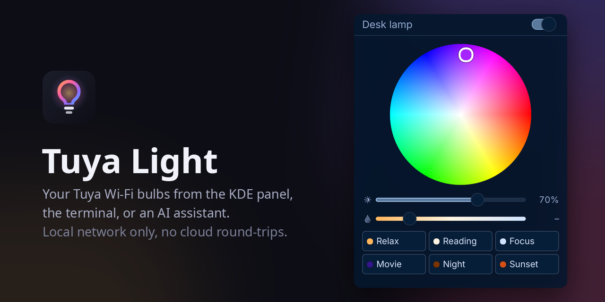
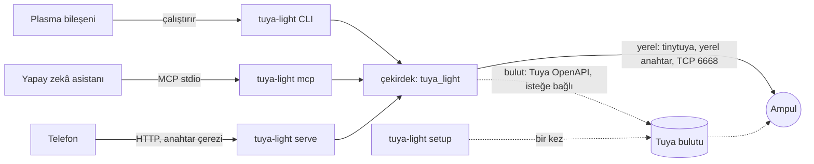

#  Tuya Light

[](https://github.com/YakupEmreYerli/tuya-light/actions/workflows/ci.yml) [](LICENSE) [](https://kde.org/plasma-desktop/)

Tuya Wi-Fi ampulleri (Smart Life, Tuya Smart ve bu altyapıyı kullanan onlarca marka) KDE Plasma panel bileşeninden, komut satırından, yapay zekâ asistanları için MCP sunucusundan ve telefonunuzdaki bir sayfadan yönetin. Varsayılan olarak hepsi ampule ev ağınız üzerinden doğrudan bağlanır. Evde olmayan bir sunucu için Tuya'nın kendi API'sinden geçen, isteğe bağlı bir bulut arka ucu da var.

> English: [README.md](README.md)



Telefon uygulaması her dokunuşta Tuya'nın bulutuna gider. Tuya Light ise ampulün yerel anahtarını kullanır: komut birkaç yüz milisaniyede ulaşır, bulut yavaşken ya da geliştirici hesabınızın deneme süresi dolmuşken de çalışır. Yerel modda bulut yalnızca kurulumda, o anahtarı almak için bir kez gerekir.

## Neler var

- **Panel bileşeni.** Ampulün o anki rengini alan bir simge. Tıklayınca renk tekerleği, parlaklık çubuğu, sıcaktan soğuğa beyaz ışık çubuğu, favori renkler ve sahneleriniz açılır. Birden fazla ampul varsa üstte seçici çıkar.
- **Kendi sahneleriniz.** Bileşenin ayarlarından sahne ekleyin, düzenleyin, gizleyin, silin ya da ışığın o anki hâlini sahne olarak kaydedin. Hazır sahneler de düzenlenir ve ilk hâline döner. Komut satırı ve MCP sunucusu aynı listeyi görür.
- **İstediğiniz gibi.** Pencerede hangi bölümlerin hangi sırayla görüneceği, teker boyutu, sahne sütunları ve favori renkler; sol tık, orta tık ve fare tekerleğinin ne yapacağı (aç, aç/kapat, bir sahne; parlaklık, sıcaklık ya da renk); panel simgesi (dört şekil, renkli ya da değil, kapalıyken soluk, yanında parlaklık).
- **Komut satırı.** `tuya-light on`, `colour purple`, `colour '#ff8800'`, `white 60 20`, `brightness 30`, `scene movie`. Ampule dokunan her komut ampulün son durumunu yazar, `--json` ile makinenin okuyacağı biçimde.
- **MCP sunucusu.** `tuya-light mcp` aynı kontrolleri araç olarak sunar; Claude gibi bir asistana "ışığı biraz ısıt" ya da "film modu" demek yeter.
- **Telefon sayfası.** `tuya-light serve` aynı kontrolleri tek elle tutulan bir telefon için tek ekrana koyar: büyük bir aç/kapat düğmesi, parlaklık, sıcaktan soğuğa beyaz ışık, renkler ve sahneleriniz. iPhone'da Ana Ekran'a eklenince uygulama gibi açılır. İsteğe bağlı.
- **İstediğiniz yerde çalışır.** Bilgisayarınızda, evde sürekli açık duran bir cihazda (systemd ya da Docker) ya da Tuya'nın bulut API'si üzerinden kiralık bir sunucuda. Bkz. [Nerede çalışır](#nerede-çalışır).
- **İki ampul nesli.** Eski (veri noktaları 1-5) ve yeni (20-24) ampuller; 3.1'den 3.5'e protokol sürümleri, [tinytuya](https://github.com/jasonacox/tinytuya) üzerinden.
- **Hazır sahneler:** Rahat, Okuma, Odak, Film, Gece, Parti.
- **Diller:** İngilizce, Türkçe.

## Gerekenler

- Python 3.10+ ve [pipx](https://pipx.pypa.io) olan bir Linux
- Bileşen için KDE Plasma 6
- Yerel anahtarları bir kez almak için ücretsiz Tuya geliştirici hesabı: [Yerel anahtarları almak](#yerel-anahtarları-almak)

## Kurulum

```bash
git clone https://github.com/YakupEmreYerli/tuya-light.git && cd tuya-light
./install.sh
```

`tuya-light` komutunu (MCP sunucusuyla birlikte) pipx ile, bileşeni `kpackagetool6` ile yalnızca sizin kullanıcınıza kurar; yönetici yetkisi istemez. `./install.sh --no-widget` bileşeni atlar, `--no-mcp` MCP bağımlılığını kurmaz, `--web` [telefon sayfasını](#telefonda) ekler ve oturum açılınca başlatır.

Sonra bileşeni ekleyin: panele sağ tık → **Bileşen Ekle ya da Yönet** → **Tuya Işık**.

Kaldırmak için: `tuya-light serve --remove-service` (telefon sayfasını eklediyseniz), `pipx uninstall tuya-light` ve `kpackagetool6 -t Plasma/Applet -r com.github.yakupemreyerli.tuyalight`.

Bileşen olmadan, doğrudan git'ten: `pipx install 'tuya-light[web] @ git+https://github.com/YakupEmreYerli/tuya-light#subdirectory=backend'`. `web` eki yalnızca eşleştirme için QR kodu ekler; telefon sayfasının kendisi Python'un standart kütüphanesinden fazlasını istemez. Yani yalnızca bileşeni kuran biri hiçbir web bağımlılığı almaz.

## Nerede çalışır

| Nerede | Arka uç | Nasıl |
| --- | --- | --- |
| Bilgisayarınız | yerel | `./install.sh`, telefon sayfası için `--web` (systemd kullanıcı servisi) |
| Evde sürekli açık duran bir cihaz | yerel | `docker compose --profile home up -d`, ya da pipx ve `tuya-light serve --install-service` |
| Kiralık sunucu (VDS), evde cihaz yok | bulut | `docker compose --profile cloud up -d`, kimlik soran bir ters vekil sunucunun (reverse proxy) arkasında |

**Yerel** mod ampulle ağınızda, yerel anahtarıyla konuşur (TCP 6668). Kurulumdan sonra buluta hiçbir şey gitmez, Tuya'nın geliştirici denemesi bitse de çalışır.

**Bulut** modu her komutu Tuya'nın sunucularına gönderir, onlar da ampule iletir. Kendi bulut projenizin Access ID ve Secret'ı ile Tuya geliştirici platformunda etkin bir IoT Core planı gerekir. Ücretsiz Trial Edition ayda yaklaşık 26.000 API çağrısı verir, bunlar bitince ay dönene kadar cevap vermez ([Tuya'nın fiyat sayfası](https://developer.tuya.com/en/docs/iot/membership-service?id=K9m8k45jwvg9j)). Ayrıntılar: [Bulut arka ucu](#bulut-arka-ucu).

Her cihaz için güçlüden zayıfa: `tuya-light --transport local|cloud`, `devices.json`'daki kaydında `"transport"`, `TUYA_LIGHT_TRANSPORT` ortam değişkeni, en son yerel.

## Telefonda

`tuya-light serve` telefon için tek ekranlık bir sayfa sunar: büyük bir aç/kapat, parlaklık, sıcaktan soğuğa beyaz ışık, birkaç renk ve tam renk seçici, büyük düğmeler hâlinde sahneleriniz. Telefonun açık ya da koyu temasına uyar, ışığın durumunu değiştikçe gösterir.


1. Bilgisayarda: `./install.sh --web`. `tuya-light[web]`'i ve `tuya-light-serve` adlı bir systemd kullanıcı servisini kurar; servis oturum açılınca başlar, çökerse yeniden başlar (8892 portu, bütün ağ arayüzleri).
2. `tuya-light serve --pair` bilgisayarın her adresi için, yani ev ağı ve kullanıyorsanız Tailscale (100.x) için, birer bağlantı ve QR kodu yazar.
3. iPhone'da bağlantıyı Safari'de açın, sonra **Paylaş → Ana Ekrana Ekle** deyin (web uygulaması olarak açma seçeneği açık kalsın). Bundan sonra uygulama gibi açılır.

Sayfa evde Wi-Fi üzerinden, dışarıda da telefonda Tailscale açıkken [Tailscale](https://tailscale.com) üzerinden çalışır. Tailscale adresi iki yerde de çalışır, ev ağı adresi yalnızca evde. Bilgisayarın açık olması gerekir: kapalıysa ya da uykudaysa sayfa bilgisayara ulaşamadığını söyler. (Düz HTTP'de iPhone sayfanın kopyasını tutamaz; bilgisayar kapalıyken simgeye dokunursanız Safari'nin kendi hata sayfası çıkar.)

**Bağlantı şifre yerine geçer.** İçindeki anahtar ilk kullanımda üretilir ve `~/.config/tuya-light/web.key` dosyasında durur (yalnızca siz okuyabilirsiniz). Telefon ilk açılışta onu bir çereze çevirir, adres çubuğu da temizlenir. Bu çerez olmadan sunucu boş sayfadan başka bir şey vermez; `devices.json`'ı, yerel anahtarları ya da bulut bilgilerini hiç göndermez. `tuya-light serve --rotate-key` eşleşmiş bütün telefonları dışarıda bırakır, sonra onları yeniden eşleştirirsiniz (iPhone'da simgeyi silip yeni bağlantıdan tekrar ekleyin). Ev ağında sayfa, ampullerin kendi trafiği gibi düz HTTP'dir; Tailscale üzerinden şifrelidir.

Servisi yönetmek:

```bash
systemctl --user stop tuya-light-serve              # bir sonraki oturuma kadar durdur
systemctl --user disable --now tuya-light-serve     # durdur, oturum açılınca da başlatma
tuya-light serve --remove-service                   # kaldır
journalctl --user -u tuya-light-serve               # günlükler
```

Servis olmadan: `tuya-light serve [--host ADRES] [--port N]`. Bilgisayarda güvenlik duvarı varsa ev ağından TCP 8892'ye izin verin. Sayfayı sunucunun tanımadığı bir adla (örneğin `pc.lan`) açarsanız "this server does not answer to the name" hatası çıkar; sunucuyu `--allow-host pc.lan` ile başlatın.

## Bulut arka ucu

Ampullerden uzaktaki bir sunucu için. Smart Life / Tuya uygulama hesabınıza bağlı bir Tuya bulut projesi ve onun Access ID ile Access Secret'ı gerekir. Adımları Tuya, [Request Tuya Cloud API Key](https://developer.tuya.com/en/docs/developer/apply-cloud-api-key?id=Kff30z8sv62ah) sayfasında anlatıyor (aynı proje aşağıdaki [Yerel anahtarları almak](#yerel-anahtarları-almak) için de işe yarar).

```bash
export TUYA_ACCESS_ID=... TUYA_ACCESS_SECRET=... TUYA_REGION=eu   # eu, us, us-e, weu, in, cn
tuya-light setup --cloud      # cihaz listesini "transport": "cloud" ile kaydeder, ağı taramaz
tuya-light --transport cloud state
```

Bilgiler önce `TUYA_ACCESS_ID`, `TUYA_ACCESS_SECRET` ve `TUYA_REGION` ortam değişkenlerinden okunur, böylece konteynerler onları ortamdan alabilir. `setup --cloud` sorduğunda elle yazarsanız `~/.config/tuya-light/cloud.json` dosyasına kaydedilir (yalnızca siz okuyabilirsiniz). Ekrana yazılmaz, günlüğe düşmez, telefon sayfasından da verilmez.

Bulut arka ucu Tuya'nın standart ışık kodlarını (`switch_led`, `work_mode`, `bright_value_v2`, `temp_value_v2`, `colour_data_v2` ve `_v2` olmayan eskileri) ampulün bildirdiği aralıklarla kullanır, `scenes.json`'daki sahneleri de komut olarak gönderir. Aylık hakkı aşmamak için süreç başına bir kez oturum açar, komuttan sonraki durumu gönderdiğinden çıkarır, çubuğun değerini yalnızca sürükleme bitince gönderir. Açık bir telefon sayfası durumu 30 saniyede bir sorar (`tuya-light serve --cloud-poll SANİYE`), ampulün bağlı olup olmadığına dakikada bir bakar. Sayfa kullanılırken bu dakikada üç kadar çağrı eder; beş dakika dokunulmazsa siz dokunana kadar sormayı bırakır. Bileşen ve komut satırı bulut modunda her komutta birkaç çağrı yapar, bu yüzden bileşeni yerel modda bırakmak en iyisi.

Trial Edition'ı Tuya geliştirici platformunda arada bir uzatmanız gerekir (**Cloud → Cloud Services → IoT Core → Extend Trial Period**). Süre dolmuşken bulut arka ucu "subscription has expired" cevabı alır, yerel mod etkilenmez.

### Docker

`compose.yaml` iki sunucu kurulumunu da içerir:

```bash
# Evde sürekli açık bir cihaz, yerel mod (ampullere ulaşsın diye host ağı)
docker compose --profile home run --rm -it home setup
docker compose --profile home up -d --build
docker compose --profile home exec home tuya-light serve --pair --url http://CIHAZ-ADRESI:8892

# Kiralık sunucu, bulut modu: TUYA_ACCESS_ID, TUYA_ACCESS_SECRET, TUYA_REGION ve
# TUYA_LIGHT_HOST'u (genel ad) compose.yaml'ın yanındaki bir .env dosyasına yazın
docker compose --profile cloud run --rm -it cloud setup --cloud
docker compose --profile cloud up -d --build
docker compose --profile cloud exec cloud tuya-light serve --pair --url https://isik.ornek.com
```

İmaj yetkisiz bir kullanıcıyla çalışır; cihaz listesi, sahneler ve eşleştirme anahtarı `config` biriminde (volume) durur.

İnternetten erişilen bir sunucuda 8892 portunu doğrudan açmayın. Compose dosyası onu 127.0.0.1'e bağlar; önüne kendi girişini isteyen bir ters vekil sunucu koyun: [Cloudflare Access](https://developers.cloudflare.com/cloudflare-one/access-controls/policies/) ile [Cloudflare Tunnel](https://developers.cloudflare.com/cloudflare-one/networks/connectors/cloudflare-tunnel/), ya da kimlik doğrulamalı Caddy veya nginx. `--trust-proxy`, sunucunun vekilin `X-Forwarded-Host`, `X-Forwarded-Proto` ve `X-Forwarded-For` başlıklarına inanmasını sağlar (HTTPS'de çerez `Secure` olur); bunu yalnızca porta vekilden başka hiçbir şey ulaşamıyorsa kullanın. `--allow-host` sayfanın açıldığı genel adı söyler.

## Yerel anahtarları almak

Her Tuya ampulü yerel trafiğini yalnızca Tuya bulutunun bildiği, cihaza özel bir anahtarla şifreler. Bu anahtarı bir kez alırsınız:

1. [platform.tuya.com](https://platform.tuya.com)'da ücretsiz hesap ve bir **Cloud Project** açın (sektör: Smart Home). Veri merkezi olarak uygulama hesabınızın bölgesini seçin; Türkiye ve Avrupa'nın çoğu için Central Europe.
2. Projede **Devices → Link App Account → Add App Account** deyin, çıkan QR kodu Tuya / Smart Life uygulamasından okutun (**Ben** → sağ üstteki tarama simgesi).
3. Projenin **Overview** sekmesinden **Access ID** ve **Access Secret**'ı, **Devices** sekmesinden de cihazlarınızdan herhangi birinin **Device ID**'sini alın.
4. Çalıştırın:

   ```bash
   tuya-light setup --region eu     # eu, us, us-e, weu, in, cn
   ```

   Üç değeri sorar, ışıklarınızın anahtarlarını çeker, ağda ampulleri arar ve listeyi yalnızca sizin okuyabildiğiniz `~/.config/tuya-light/devices.json` dosyasına yazar. ID ve secret `TUYA_API_KEY` ile `TUYA_API_SECRET` ortam değişkenlerinden de verilebilir.

Ücretsiz IoT Core denemesi bir ay sürer, sonra bulut "subscription has expired" cevabı verir. Yerel kontrol bundan etkilenmez. Buluta yeniden ancak bir ampul sıfırlanıp tekrar eşleştirilirse gerek olur, çünkü anahtarı değişir. Deneme süresi **Cloud → Cloud Services → IoT Core → Extend Trial Period** yolundan ücretsiz uzatılabilir.

`python -m tinytuya wizard` ile üretilmiş bir `devices.json` olduğu gibi çalışır. İçinde yerel anahtarlar olduğu için tuya-light onu ilk okuduğunda yalnızca sizin okuyabileceğiniz hâle (0600) getirir ve bunu söyler.

## Komut satırı

```text
tuya-light [-d CİHAZ] [--json] KOMUT
```

| Komut | Ne yapar |
| --- | --- |
| `state` | Anlık durumu gösterir |
| `on`, `off`, `toggle` | Açar, kapatır, tersine çevirir |
| `colour AD` / `colour '#rrggbb'` / `colour H S V` | Renkli ışık. Adlar: red, orange, yellow, green, cyan, blue, purple, pink. H 0-360, S ve V 0-100 |
| `white PARLAKLIK [SICAKLIK]` | Beyaz ışık, ikisi de 0-100; sıcaklık 0 sıcak, 100 soğuk |
| `brightness YÜZDE` | Rengi ya da beyaz tonu koruyarak kısar, açar |
| `temperature YÜZDE` | Beyaz ışık sıcaklığı, beyaza geçer |
| `scene AD` | Adı ya da etiketiyle sahne uygular |
| `scene-save ETİKET --colour RENK\|--white SICAKLIK\|--current [--brightness N]` | Sahne oluşturur ya da üzerine yazar; `--current` ışığın o anki hâlini alır |
| `scene-remove AD` | Kendi sahnenizi siler (hazır sahne gizlenir) |
| `scene-hide AD`, `scene-show AD` | Listelerden ve bileşenden gizler, geri gösterir |
| `scene-reset [AD]` | Hazır sahneleri ilk hâline döndürür |
| `devices`, `scenes [--all]` | Tanımlı olanları listeler (`--all` gizli sahneleri de gösterir) |
| `setup [--region B] [--device-id KİMLİK] [--all] [--cloud]` | Yerel anahtarları buluttan alır (bir kez). `--device-id` soruyu atlar; `--all` ışık dışı cihazları da tutar; `--cloud` ışıkları bulut arka ucu için kurar |
| `mcp` | MCP sunucusunu stdio üzerinde çalıştırır |
| `serve [--host ADRES] [--port N] [--allow-host AD] [--trust-proxy] [--cloud-poll S]` | Telefon sayfasını çalıştırır (varsayılan: bütün arayüzler, 8892 portu) |
| `serve --pair [--url URL]` | Her adres için, ya da `URL` için, eşleştirme bağlantısını ve QR kodunu yazar |
| `serve --rotate-key` | Yeni anahtar üretir; eşleşmiş her telefonun yeniden eşleşmesi gerekir |
| `serve --install-service`, `serve --remove-service` | Telefon sayfasını aynı seçeneklerle systemd kullanıcı servisi olarak oturum açılınca başlatır, ya da kaldırır |

`-d` cihaz kimliği ya da adı alır, verilmezse listedeki ilk cihaz. `--transport local|cloud` o çalıştırma için ışıklara nasıl ulaşılacağını değiştirir. Çıkış kodları: 0 tamam, 2 ışık cevap vermedi, 3 cihaz listesi yok ya da bulut bilgileri eksik.

Sahneler `~/.config/tuya-light/scenes.json` dosyasında durur; dosyada yalnızca hazır sahnelerden farklı olanlar tutulur.

```bash
tuya-light scene-save "Kitap köşesi" --white 30 --brightness 80
tuya-light scene-save "Gün batımı" --colour '#ff6a2a' --brightness 70
tuya-light scene-save "Koyu mavi" --colour "230 80" --brightness 40   # renk tonu, doygunluk
tuya-light scene-save "Şu an" --current
tuya-light scene "kitap köşesi"
```

## MCP sunucusu

Araçlar: `list_devices`, `list_scenes`, `get_state`, `turn_on`, `turn_off`, `toggle`, `set_colour`, `set_white`, `set_brightness`, `apply_scene`, `save_scene`, `remove_scene`. Her değişiklik ışığın yeni durumunu döndürür. `save_scene` varsayılan olarak ışığın o anki hâlini kaydettiği için "bunu Akşam diye kaydet" demek yeter.

Claude Code:

```bash
claude mcp add tuya-light -- tuya-light mcp
```

Claude Desktop, Cursor ve diğerleri (JSON ayarındaki `mcpServers`):

```json
{
  "mcpServers": {
    "tuya-light": { "command": "tuya-light", "args": ["mcp"] }
  }
}
```

## Bileşen ayarları

Simgeye sağ tık → **Yapılandır…**. Dört sekme:

| Sekme | Neler ayarlanır |
| --- | --- |
| Görünüm | Pencerede hangi bölümlerin hangi sırayla görüneceği (renk tekerleği, parlaklık, beyaz ışık sıcaklığı, favori renkler, sahneler); teker boyutu; sahne sütunları; favori renkler; panel simgesinin şekli, rengi, kapalıyken solması, yanında parlaklık |
| Davranış | Sol ve orta tık: kontrolleri aç, ışığı aç/kapat, seçtiğiniz bir sahneyi uygula ya da hiçbir şey. Fare tekerleği: parlaklık, beyaz ışık sıcaklığı, renk ya da hiçbir şey; adım büyüklüğü ve yön |
| Sahneler | Kendi sahneleriniz ve hazır olanlar: ışıkta dene, düzenle (renk tekerleği ya da beyaz çubukları, "ışıktan al" ile), gizle, sil, ilk hâline döndür |
| Cihaz | Hangi ampul, ne sıklıkla kontrol edileceği, arka uç komutu, bağlantı testi |

Varsayılanlar: sol tık kontrolleri açar, orta tık ışığı açıp kapatır, tekerlek parlaklığı %5 değiştirir.

## Nasıl çalışır



Bileşenin içinde Python yok: komut satırı aracını çalıştırıp tek satırlık JSON cevabını okur. Bir komut sürerken gelen yeniler birbirinin yerine geçer; çubuğu sürüklerken ampule yüzlerce komut değil, ilk ve son değer gider. Telefon sayfasının sunucusu her ampul için aynı kurala uyar, bulut ampullerinde de sürükleme bitene kadar bekler.

```text
backend/     Python paketi: çekirdek (yerel ve bulut), CLI, MCP sunucusu, telefon sayfası, testler
plasma/      Plasma 6 bileşeni (QML)
po/          çeviriler
tools/       ekransız görüntüler, sahte ampullerle telefon sayfası, simgeler, banner, çeviri betikleri
Dockerfile, compose.yaml   konteynerde sunucu
```

## Sorun giderme

- **"Işık cevap vermiyor"**: ampul ile bilgisayar aynı ağda ve aynı alt ağda olmalı; aradaki Wi-Fi güçlendirici sorun değil. Ampulün IP'si değiştiyse `tuya-light setup`'ı yeniden çalıştırın ya da modemden ampule sabit adres verin.
- **"Henüz ışık eklenmedi"**: `tuya-light setup` çalıştırın.
- **Kurulumda "subscription has expired"**: ücretsiz IoT Core denemesini uzatın (yukarıda).
- **Kurulum 0 cihaz buluyor**: uygulama hesabı bulut projesine bağlı değil ya da projenin veri merkezi uygulamanın bölgesinden farklı.
- **Telefon bilgisayara ulaşamıyor**: telefon bilgisayarla aynı ağda olmalı ya da Tailscale'i açık olmalı; bilgisayardaki güvenlik duvarı TCP 8892'yi içeri almalı; servis de çalışıyor olmalı (`systemctl --user status tuya-light-serve`).
- **"Bu telefon henüz eşleşmedi"**: `tuya-light serve --pair` bağlantısını o telefonda açın. `--rotate-key`'den önce eklenmiş Ana Ekran simgesini silip yeniden eklemek gerekir.
- **Bulut: "subscription has expired" ya da "permission deny"**: IoT Core planını uzatın; uygulama hesabının bulut projesine hâlâ bağlı olduğuna ve bölgenin tuttuğuna bakın.

## Katkı

[CONTRIBUTING.md](CONTRIBUTING.md)'ye bakın. Hata bildirirken `tuya-light --json state` çıktısını eklerseniz çok işe yarar.

## Emeği geçenler

- Tuya protokolünü [tinytuya](https://github.com/jasonacox/tinytuya) (Jason Cox, MIT) konuşuyor.
- [MCP Python SDK](https://github.com/modelcontextprotocol/python-sdk) (MIT).
- Eşleştirme QR kodlarını, kuruluysa [segno](https://github.com/heuer/segno) (BSD-3-Clause) çiziyor.
- Penceredeki simgeler Plasma simge temanızdan gelir; ampul simgesi ve logo bu projenin.

Tuya Inc. ile bağı yoktur. "Tuya" adı yalnızca hangi cihazlarla çalıştığını söylemek için geçer.

## Lisans

[GPL-2.0-or-later](LICENSE).
